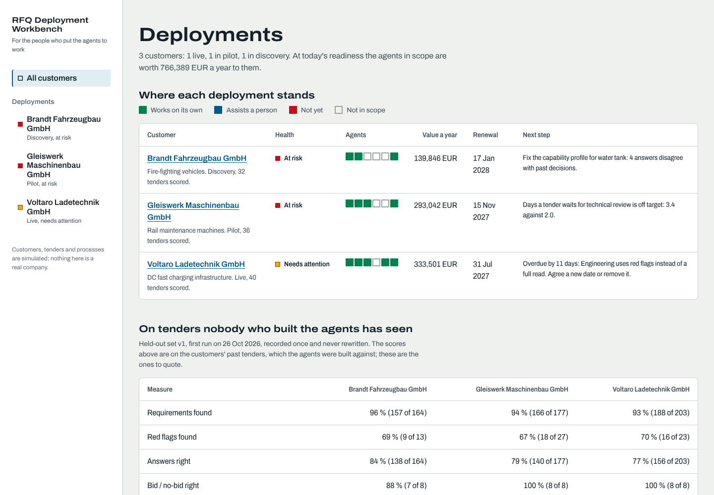
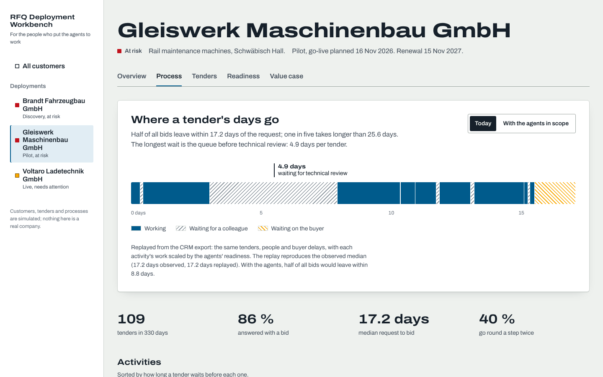
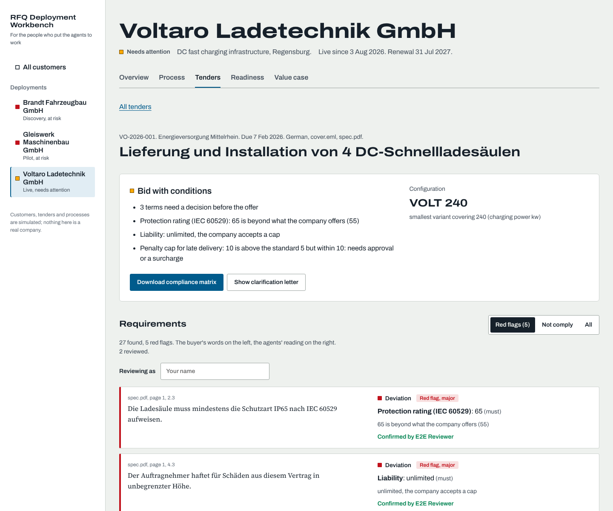
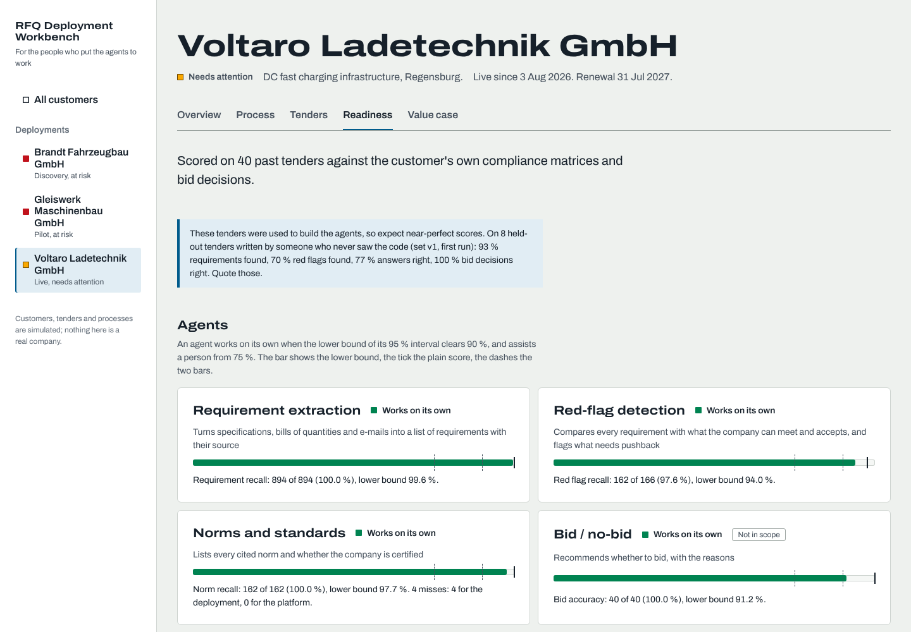
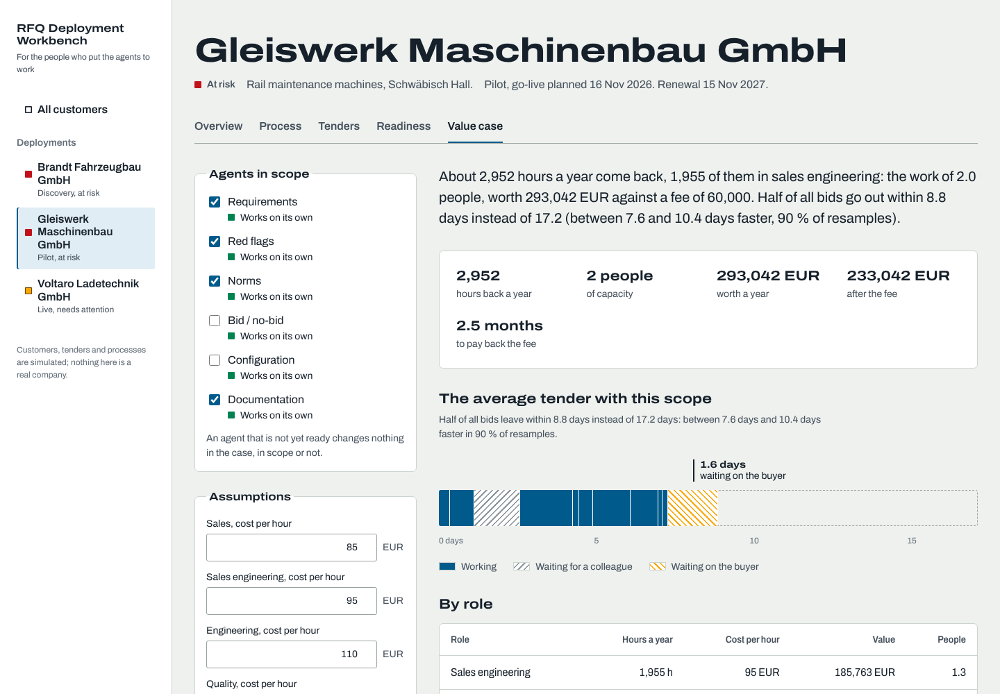

# RFQ Deployment Workbench

The tool I would want on my first day as a Deployment Strategist for RFQ agents: it takes what an industrial
customer hands over (past tenders with their compliance matrices, and a CRM export of the quote process)
and answers the questions a deployment lives or dies by.

- **Where does this customer's quote process lose time?** Process mining of the CRM export: work against
  waiting, internal queues against waiting on the buyer, utilisation by role, the paths tenders take.
- **Which agents are ready for this customer, and which are not?** Every agent is scored against the
  customer's own past decisions. Readiness is the lower bound of a Wilson interval, so a pilot on ten
  tenders cannot look better than it is. Every miss is kept with its cause, which decides who fixes it:
  the deployment (the customer's capability or norm profile) or the platform (vocabulary, parsing, rules).
- **What is it worth?** The same tenders, people and buyer delays are replayed with each activity's work
  cut by the agents' readiness. Hours by role, people freed, lead time with a bootstrap interval, payback
  against the fee. The replay has to reproduce the observed lead time before any number is quoted.
- **Is the deployment on track?** Agreed KPIs with their basis (measured, projected or scored), milestones,
  adoption since go-live per activity, and next steps worked out from all of it. A SteerCo pack in one click.
- **What should the product fix?** Across customers: misses that recur at more than one customer, the
  requirement kinds every customer shares (core) against those only one has (deployment work), and an
  onboarding playbook from the plans.

The agents themselves (requirement extraction, red flags, norms report, bid/no-bid, configuration,
compliance matrix and clarification letter) run on real PDF, Excel and e-mail tenders in German and
English. They are rule-based on purpose: they are the thing being deployed, and the workbench is about
deploying them. Models read; rules decide; a person confirms each answer in the console.



## Honest numbers

The three customers are simulated (see below), and the agents were built against their past tenders, so
those scores are close to 100 % and mean little. The scores to quote come from a **held-out set**:
24 tenders written by someone who never saw the code, from [`heldout/WRITING_TENDERS.md`](heldout/WRITING_TENDERS.md)
only. Its first run is recorded once in [`reports/heldout/v1/first_run.json`](reports/heldout/v1/first_run.json)
and CI fails if it is ever rewritten.

| Held-out v1, first run | Brandt (fire trucks) | Gleiswerk (rail machines) | Voltaro (DC chargers) |
| --- | --- | --- | --- |
| Requirements found | 157 / 164 (96 %) | 166 / 177 (94 %) | 188 / 203 (93 %) |
| Red flags found | 9 / 13 (69 %) | 18 / 27 (67 %) | 16 / 23 (70 %) |
| Answers right (comply, clarify, deviate) | 138 / 164 (84 %) | 140 / 177 (79 %) | 156 / 203 (77 %) |
| Bid / no-bid right | 7 / 8 | 8 / 8 | 8 / 8 |
| Never bid where the customer would not | 8 / 8 | 8 / 8 | 8 / 8 |

Of the 128 held-out misses, 89 are vocabulary and 23 are value parsing: platform work, not deployment
work. That is the point of the split: on new phrasing the agents find the requirements but miss about a third
of the red flags, so a person has to confirm red flags at every customer, and the product team gets a
ranked backlog instead of anecdotes. I have not looked at the missed sentences; if anyone does, the set
becomes a regression set and a new one has to be written.

## The console

React, TypeScript and Framer Motion, served by the API. Feature folders (portfolio, customer overview,
process, tenders, readiness, value case), one token file for every colour, size and duration, and every
view has a loading skeleton, an error with a retry (or a token prompt when the API wants one) and an empty
state that says what to do.

| | |
| --- | --- |
|  |  |
| **Process.** Where the average tender's days go: working (solid), waiting for a colleague (hatched), waiting on the buyer (yellow). Switching to "with the agents" replays the process; the dashed outline is today. | **Tender review.** The buyer's words (serif, with file and page) beside the agents' reading. Confirm or change each answer; reviews feed the compliance matrix and the acceptance KPI. |
|  |  |
| **Readiness.** Lower bound, plain score and the two bars per agent, the held-out scores beside them, misses split by who fixes them. | **Value case.** Change the scope or the customer's hourly costs and the case and the strip follow; save the assumptions the customer agreed. |

Colours are the RAL traffic colours the customers' own shop floors use (5017 blue, 6024 green, 1003 yellow,
3020 red), always with a word next to them. Archivo (variable width) carries the interface; Source Serif 4
is reserved for the buyer's own text. Dark mode and phone layouts are tested.

## The three customers

| | Stage | What the data shows |
| --- | --- | --- |
| **Gleiswerk Maschinenbau** (rail maintenance machines) | Pilot | Tenders wait 4.9 days for one engineer's technical review; median 17.2 days to bid, 8.8 projected. Health red: the engineering-wait KPI is off target. |
| **Voltaro Ladetechnik** (DC fast chargers) | Live since August | Lead time 6.5 → 3.4 days measured since go-live (2.9 projected). Configure-and-price and technical review lag the plan: an adoption gap, not a model gap. A grid-connection norm is missing from the profile. |
| **Brandt Fahrzeugbau** (fire trucks) | Discovery | Most of the lead time is waiting for municipalities to answer. Agents cannot shorten that wait; one complete clarification letter instead of three rounds can. The water-tank limit in the profile is wrong. |

The data is written by `rdw-sim`: specifications as PDF, bills of quantities as Excel, cover e-mails,
a year of quote activities as a CRM export, and the answer key beside it. Only `src/rdw/evaluate.py` reads
the answer key; `tests/test_isolation.py` checks that nothing else does. Two profile errors are planted on
purpose (a capacity limit and an uncertified norm) so the workbench has something real to find.

## Claude in the loop

[`skills/`](skills/) holds four Claude skills for strategists (SteerCo prep, scoping a deployment, product
feedback from the field, tender triage) and [`.mcp.json`](.mcp.json) the MCP server they use
(`python -m rdw.mcp_server`, 11 tools: customer brief, readiness, process bottleneck, value case, adoption
since go-live, SteerCo pack, platform signals, held-out results, tender summary, record decision).
A test checks that every skill calls only tools the server has. The held-out tool returns counts, never
the missed sentences.

## Run it

```bash
pip install -e ".[dev]"
rdw-sim                                   # the three customers, about a minute
RDW_TODAY=2026-10-26 rdw serve            # API and console on http://localhost:8000
(cd web && npm ci && npm run build)       # build the console once first

rdw discover --customer brandt            # where the quote process waits
rdw value --customer gleiswerk            # the value case
rdw steerco --customer voltaro            # the SteerCo pack
rdw analyse data/customers/voltaro/tenders/VO-2026-001 --customer voltaro
rdw heldout v1                            # scores the held-out set; the first run is never rewritten
```

Or `docker compose up` for the image with PostgreSQL. `RDW_DATABASE_URL` switches reviews, decisions and
assumptions from SQLite to PostgreSQL; `RDW_API_TOKEN` makes every API call require a bearer token.

## Tests

| | |
| --- | --- |
| `pytest -q` | 46 tests: extraction, assessment, pipeline on the generated tenders, truth isolation, API (also on PostgreSQL in CI), MCP tools, skills |
| `cd web && npm run check` | types, lint, format, 28 Vitest tests rendering the real routes against API responses captured from the running server |
| `cd web && npx playwright test` | 4 journeys on desktop and phone against the real API: portfolio to process, review and download, value case, unknown addresses |
| CI | all of the above, the generated reports must match a fresh build, the held-out first run must not change, and the Docker image must serve the API and the console |

## Layout

```
src/rdw/          ingest, extract, assess, pipeline     the agents on one tender
                  evaluate                               scoring against the answer key (only reader of truth)
                  discovery, value                       process mining, replay, value case
                  service, store, api, mcp_server        the workbench, its database, HTTP and MCP
src/rdw_sim/      the simulated customers and their answer keys
config/           thresholds, agents, vocabularies per domain, one folder per customer
heldout/          held-out sets and the guide they are written from
web/src/          app/, shared/ (api, theme, ui, charts), features/<screen>/
skills/           Claude skills for strategists
docs/             RESEARCH.md (what the role and the market ask for), adr/, DESIGN.md
```

## Limits

- The customers, their tenders and their processes are simulated. The replay is only as good as the CRM
  export; with real data, the first job is checking that the replay reproduces observed lead times.
- The extraction is rule-based and German/English only; the held-out set shows where it breaks.
- Value is hours times hourly cost. It does not count bids won because they went out sooner, which is
  usually the bigger number and the harder one to prove.

Not affiliated with any company named in [`docs/RESEARCH.md`](docs/RESEARCH.md).
